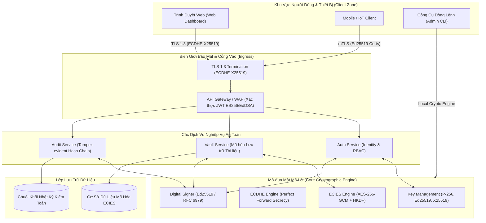
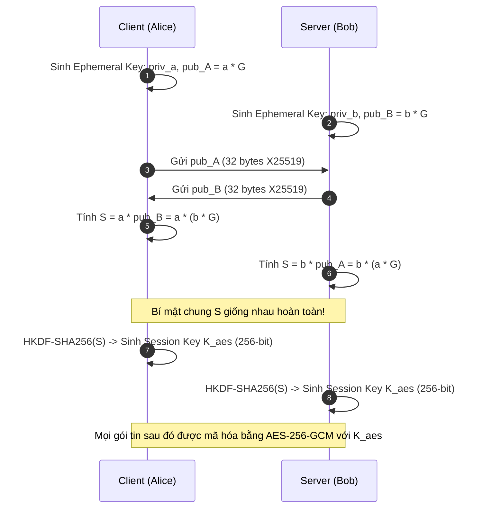
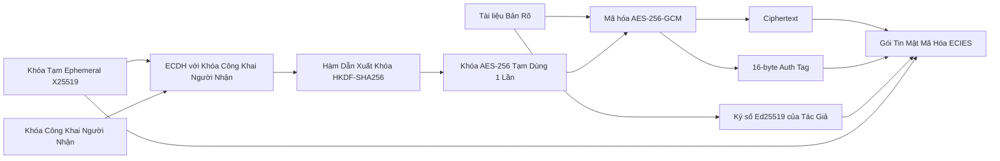

# Sơ Đồ & Thiết Kế Kiến Trúc Hệ Thống Thông Tin An Toàn ECC-SecureGuard

Tài liệu này mô tả chi tiết kiến trúc tầng, mô hình đe dọa (Threat Model), luồng dữ liệu mật mã, và cơ chế phòng ngự của hệ thống **ECC-SecureGuard**.

---

## 1. Sơ Đồ Kiến Trúc Hệ Thống (Architecture Blueprint)

---

## 2. Luồng Dữ Liệu Mật Mã (Cryptographic Data Flows)

### 2.1. Luồng Bắt Tay Trao Đổi Khóa Phiên (ECDHE Flow)

### 2.2. Luồng Mã Hóa Phong Bì Tài Liệu Mật (ECIES Envelope Encryption)

---

## 3. Mô Hình Đe Dọa (Threat Model) & Giải Pháp Phòng Thủ

| Nguy Cơ Tấn Công | Điểm Yếu Tiềm Ẩn Cổ Điển | Cơ Chế Phòng Ngự Trong ECC-SecureGuard |
| :--- | :--- | :--- |
| **Kẻ đứng giữa (Man-in-the-Middle - MITM)** | Nghe lén và tráo đổi khóa trong lúc bắt tay trao đổi khóa | Khóa công khai trao đổi được bảo chứng qua chữ ký số hoặc chứng chỉ mTLS đã xác thực. |
| **Lộ khóa trong tương lai (Future Key Compromise)** | Kẻ tấn công ghi lại lưu lượng hôm nay, chờ lộ khóa Master Key để giải mã | Bắt buộc dùng **ECDHE (Ephemeral)**: Mỗi phiên dùng một cặp khóa dùng-một-lần, bảo đảm **Perfect Forward Secrecy**. |
| **Tái sử dụng Nonce (Nonce Reuse - Sony PS3 Attack)** | Bộ sinh số ngẫu nhiên bị lỗi lặp lại nonce $k$ khi ký ECDSA | Kích hoạt **RFC 6979 Deterministic Nonce** hoặc chuyển hẳn sang **Ed25519** (loại bỏ hoàn toàn bộ sinh ngẫu nhiên khi ký). |
| **Tấn công Kênh Kề (Timing & Power Side-Channel)** | Thời gian tính toán phụ thuộc vào số bit 0 hoặc 1 của private key | Toàn bộ phép toán trên **Curve25519 / Ed25519** được triển khai theo nguyên tắc **Constant-Time** (thời gian thực thi độc lập với dữ liệu bí mật). |
| **Invalid Curve / Small Subgroup Attack** | Gửi điểm $P'$ không thuộc đường cong để ép server tính toán trên nhóm con nhỏ | **Point Validation Filter:** Kiểm tra tọa độ điểm thỏa mãn phương trình đường cong trước khi thực hiện phép nhân vô hướng. |
| **Sửa đổi trái phép Nhật ký kiểm toán** | Kẻ xâm nhập xóa hoặc sửa bản ghi log để che giấu vết tích | **Tamper-Evident Hash Chain:** Mỗi sự kiện liên kết băm SHA-256 với sự kiện trước và được ký số Ed25519 của hệ thống. Bất kỳ sửa đổi 1 ký tự nào cũng làm gãy toàn bộ chuỗi. |
