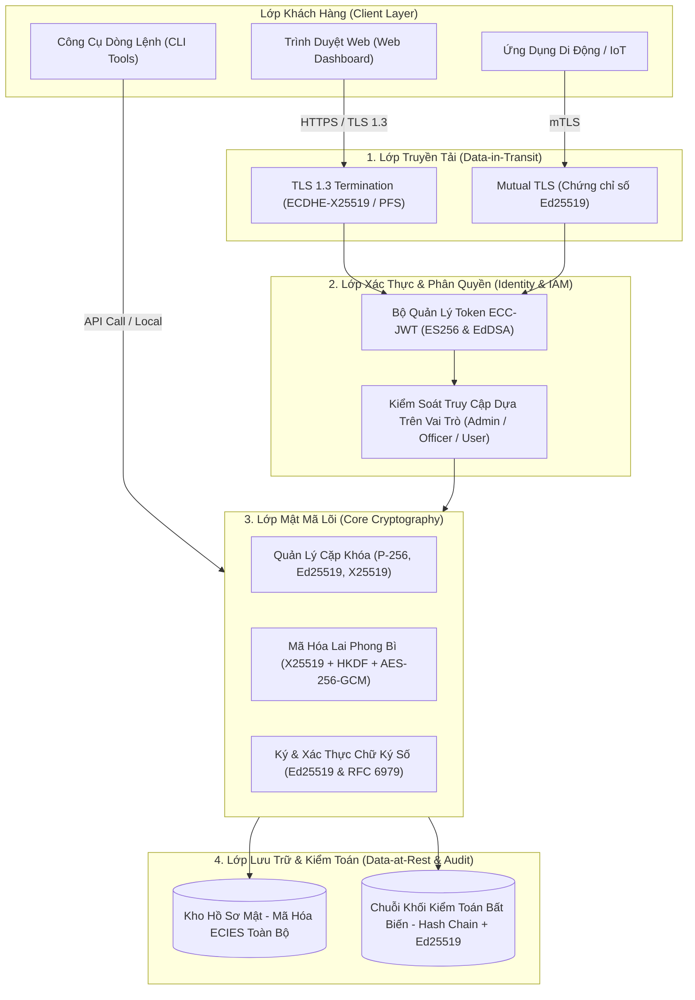
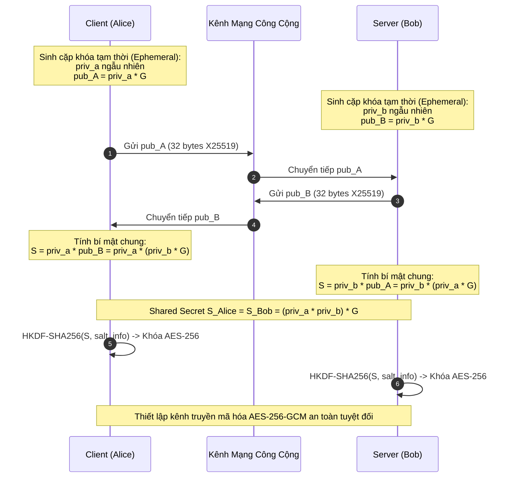
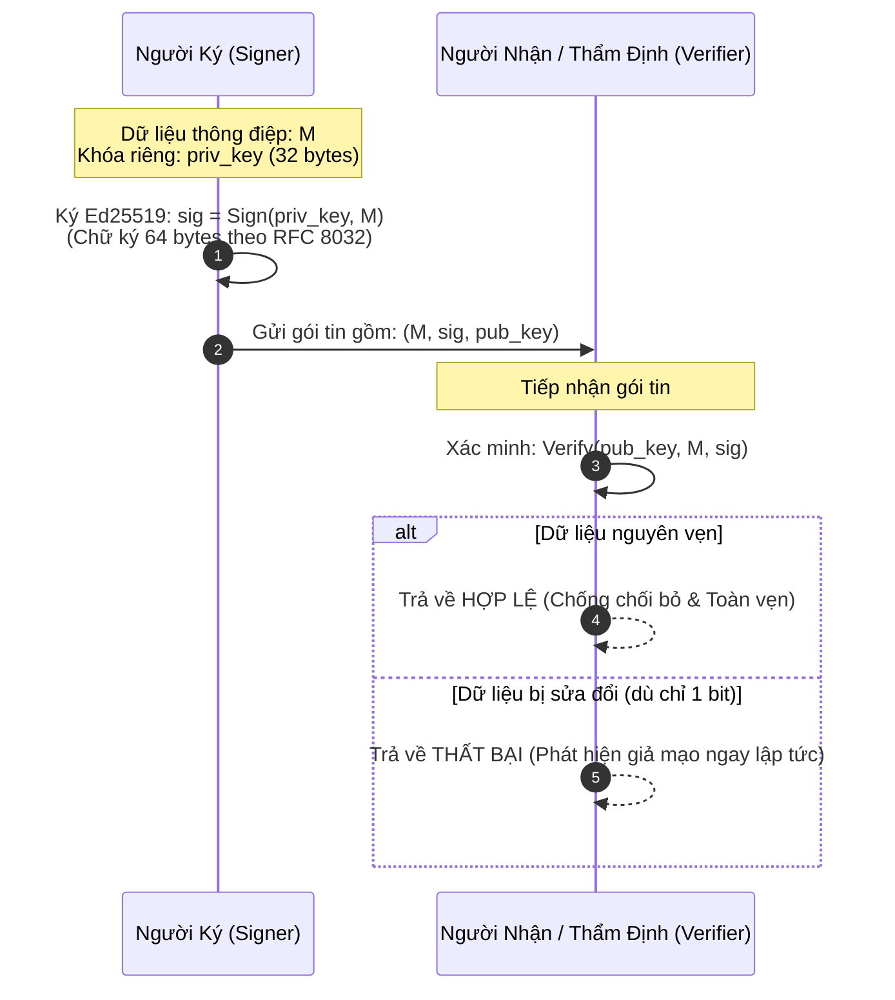

# VNU-IS_ECC: Hệ Thống Thông Tin An Toàn Ứng Dụng Thuật Toán Mật Mã Đường Cong Elliptic (ECC)

---

## 👥 Thông Tin Tác Giả & Đơn Vị Nghiên Cứu

* **Tác giả:**
  * **Bùi Kim Ngân**
  * **Nguyễn Tuấn Minh**
* **Đơn vị nghiên cứu:** **AIVN**
* **Dự án:** Triển khai và thực nghiệm hệ thống thông tin an toàn sử dụng Mật mã Đường cong Elliptic (Elliptic Curve Cryptography - ECC)
* **Phiên bản:** `1.0.0 (Production Release)`

---

## 📖 1. Giới Thiệu & Bối Cảnh Nghiên Cứu

Trong kỷ nguyên số và truyền thông phân tán, an toàn thông tin đối mặt với thách thức kép: vừa phải đảm bảo mức độ bảo mật tối đa trước các kỹ thuật thám mã tinh vi, vừa phải tối ưu hóa tài nguyên phần cứng, băng thông mạng và độ trễ xử lý.

Hệ thống mật mã truyền thống như RSA dựa trên bài toán phân tích số nguyên tố lớn đang bộc lộ những hạn chế nghiêm trọng: để duy trì mức an toàn tương đương 128-bit, RSA cần kích thước khóa lên tới 3072 bits, gây tốn băng thông, tiêu thụ năng lượng cao và tốc độ sinh khóa rất chậm.

**VNU-IS_ECC** được thiết kế và triển khai nhằm giải quyết triệt để bài toán này bằng cách ứng dụng **Mật mã Đường cong Elliptic (ECC)** trên nền tảng **Bài toán Logarit Rời rạc Đường cong Elliptic (ECDLP - Elliptic Curve Discrete Logarithm Problem)**:
* Với khóa chỉ **256 bits**, ECC cung cấp độ an toàn tương đương RSA 3072 bits.
* Kích thước chữ ký chỉ **64 bytes** (thay vì 384 bytes của RSA-3072).
* Tốc độ sinh khóa và ký số nhanh gấp **hàng chục đến hàng nghìn lần** so với RSA.

Dự án triển khai một hệ sinh thái an ninh mạng toàn diện gồm:
1. **Giao thức đàm phán khóa ECDHE (X25519 & NIST P-256)** bảo đảm tính bảo mật chuyển tiếp hoàn hảo (**Perfect Forward Secrecy - PFS**).
2. **Mã hóa lai ECIES (Elliptic Curve Integrated Encryption Scheme)** kết hợp **X25519 + HKDF-SHA256 + AES-256-GCM** để bảo vệ dữ liệu tĩnh và hồ sơ nhạy cảm.
3. **Chữ ký số Ed25519 (EdDSA)** và **ECDSA P-256 (Deterministic Nonce RFC 6979)** chống giả mạo và chống chối bỏ.
4. **Cơ chế xác thực Token định danh ECC-JWT (`ES256` & `EdDSA`)**.
5. **Chuỗi kiểm toán bất biến (Tamper-evident Hash Chain)** liên kết băm SHA-256 và ký số Ed25519.
6. **Phòng thí nghiệm an ninh** chứng minh toán học vụ tấn công rò rỉ khóa kinh điển **Nonce Reuse (Sony PlayStation 3)** và kỹ thuật phòng thủ **Invalid Curve Point Validation**.

---

## 📂 2. Cấu Trúc Thư Mục Dự Án (Directory Structure)

```
VNU-IS_ECC/
├── server.js                   # Máy chủ chính Express REST API & Web Dashboard
├── package.json                # Định cấu hình dự án, scripts chạy và kiểm thử
├── README.md                   # Tài liệu kỹ thuật chi tiết và hướng dẫn vận hành
├── ARCHITECTURE.md             # Thiết kế kiến trúc, mô hình dữ liệu và threat model
├── src/
│   ├── crypto/                 # Thư viện Mật mã Cốt lõi (Hardware Accelerated)
│   │   ├── curves.js           # Đặc tả các đường cong: P-256, P-384, secp256k1, Ed25519, X25519
│   │   ├── keyManager.js       # Sinh khóa, xuất nhập PEM/JWK, SHA-256 Fingerprint
│   │   ├── ecdhExchange.js     # Đàm phán khóa ECDHE & dẫn xuất khóa phiên HKDF-SHA256 (PFS)
│   │   ├── eciesHybrid.js      # Mã hóa lai phong bì ECIES (AES-256-GCM + X25519)
│   │   ├── digitalSignature.js # Chữ ký số Ed25519 & ECDSA P-256 (RFC 6979 Deterministic)
│   │   ├── jwtEcc.js           # Bộ phát hành & thẩm định Token JWT ký bằng ES256 & EdDSA
│   │   ├── attackSimulator.js  # Mô phỏng bẻ khóa lặp Nonce (vụ PS3) & Invalid Curve
│   │   └── benchmark.js        # Đo lường hiệu năng thực tế CPU (ECC vs RSA)
│   ├── services/
│   │   ├── authService.js      # Dịch vụ xác thực tài khoản & phân quyền RBAC
│   │   ├── vaultService.js     # Dịch vụ kho lưu trữ tài liệu mật mã hóa ECIES
│   │   └── auditService.js     # Dịch vụ nhật ký kiểm toán Hash-Chain ký số Ed25519
│   └── routes/
│       └── api.js              # Router cung cấp 18 RESTful API Endpoints
├── public/                     # Giao diện Web Dashboard Trực quan
│   ├── index.html              # Ứng dụng Single Page Application Dashboard 8 Tab
│   ├── styles.css              # Cyber-Dark Security Theme Styling
│   └── app.js                  # Frontend Controller tương tác dữ liệu thời gian thực
├── scripts/
│   ├── ecc_cli.js              # Công cụ dòng lệnh CLI tương tác quản trị hệ thống
│   └── ecc_demo.py             # Script Python minh họa toán học đường cong Weierstrass
└── tests/
    ├── crypto.test.js          # Unit tests thuật toán mật mã
    └── api.test.js             # Integration tests toàn bộ REST API
```

---

## 🔄 3. Kiến Trúc Luồng & Sơ Đồ Hệ Thống (System Workflows & Diagrams)

### 3.1. Sơ Đồ Kiến Trúc Đa Tầng (Multi-Tier Security Architecture)

Hệ thống được thiết kế theo nguyên tắc "Phòng thủ chiều sâu" (*Defense in Depth*) với 4 lớp bảo mật độc lập:



---

### 3.2. Luồng Bắt Tay Trao Đổi Khóa Phiên ECDHE (Perfect Forward Secrecy)

Giao thức bảo đảm hai thực thể qua kênh mạng công cộng có thể đàm phán một khóa phiên AES-256 dùng một lần:



---

### 3.3. Luồng Mã Hóa Lai Phong Bì ECIES (Data-at-Rest Envelope Encryption)


---

### 3.4. Luồng Ký Số & Xác Thực Toàn Vẹn Ed25519



---

### 3.5. Chuỗi Băm Nhật Ký Kiểm Toán Bất Biến (Tamper-Evident Hash Chain)

Mọi hành động nhạy cảm trong hệ thống được liên kết tuần tự qua hàm băm SHA-256 và bảo chứng bằng chữ ký Ed25519:

```mermaid
stateDiagram-v2
    direction LR
    
    state "Sự Kiện #0 (Genesis)" as E0 {
        PrevHash0 : PrevHash = 0000...0000
        Action0 : USER_REGISTERED (admin)
        Hash0 : Hash = SHA256(Event #0)
        Sig0 : Chữ Ký Ed25519 Hệ Thống
    }

    state "Sự Kiện #1" as E1 {
        PrevHash1 : PrevHash = Hash(Event #0)
        Action1 : DOCUMENT_STORED_ENCRYPTED
        Hash1 : Hash = SHA256(Event #1)
        Sig1 : Chữ Ký Ed25519 Hệ Thống
    }

    state "Sự Kiện #2" as E2 {
        PrevHash2 : PrevHash = Hash(Event #1)
        Action2 : DOCUMENT_DECRYPTED
        Hash2 : Hash = SHA256(Event #2)
        Sig2 : Chữ Ký Ed25519 Hệ Thống
    }

    E0 --> E1 : Liên kết băm SHA-256
    E1 --> E2 : Liên kết băm SHA-256
```



---

## ⚡ 4. Đặc Tả Các Đường Cong Chuẩn Được Hỗ Trợ

| Tên Đường Cong | Chuẩn Quy Định | Dạng Đại Số | Độ Dài Khóa | Mức An Toàn | Ứng Dụng Trọng Tâm |
| :--- | :--- | :--- | :--- | :--- | :--- |
| **NIST P-256 (prime256v1)** | FIPS 186-4 / SECG | Weierstrass | 256 bits | 128-bit | WebAuthn, Passkeys, SSL/TLS Certificates, FIPS Enterprise |
| **NIST P-384 (secp384r1)** | NSA Suite B / CNSA | Weierstrass | 384 bits | 192-bit | An ninh quốc phòng, bảo vệ dữ liệu tối mật (Top Secret) |
| **secp256k1** | SECG (Certicom) | Koblitz | 256 bits | 128-bit | Mạng Blockchain (Bitcoin, Ethereum), Hợp đồng thông minh |
| **Ed25519** | RFC 8032 / IETF | Twisted Edwards | 256 bits | 128-bit | Chữ ký số tốc độ cao, Constant-time, xác thực API/Microservices |
| **Curve25519 (X25519)** | RFC 7748 / IETF | Montgomery | 256 bits | 128-bit | Trao đổi khóa ECDH, WireGuard VPN, Signal Protocol, TLS 1.3 |

---

## 🔬 5. Phân Tích Lỗ Hổng Mật Mã & Kỹ Thuật Phòng Thủ

### 5.1. Thảm Họa Tái Sử Dụng Nonce Trong ECDSA (Vụ Sony PS3 - 2010)
* **Nguyên lý tấn công:** Thuật toán ký ECDSA yêu cầu một số ngẫu nhiên bí mật $k$ (Nonce) cho mỗi lần ký. Nếu kẻ tấn công thu thập được 2 chữ ký $(r, s_1)$ và $(r, s_2)$ trên hai thông điệp $m_1, m_2$ dùng cùng một số $k$:
  $$k = \frac{H(m_1) - H(m_2)}{s_1 - s_2} \pmod n$$
  Sau khi tìm được $k$, khóa riêng $d$ bị khôi phục ngay lập tức:
  $$d = \frac{s_1 \cdot k - H(m_1)}{r} \pmod n$$
* **Giải pháp trong VNU-IS_ECC:**
  1. Kích hoạt chuẩn **RFC 6979 (Deterministic Nonce)**: Nonce $k$ được tạo xác định bằng $HMAC(d, H(m))$, không bao giờ trùng lặp giữa hai thông điệp khác nhau.
  2. Khuyến nghị chuẩn hóa sang **Ed25519**: Thuật toán EdDSA hoàn toàn không sử dụng bộ sinh ngẫu nhiên khi ký, triệt tiêu vĩnh viễn rủi ro này.

### 5.2. Tấn Công Kênh Kề (Side-Channel Timing Attacks)
* **Nguy cơ:** Kẻ tấn công đo thời gian thực thi của phép nhân đôi và cộng điểm (`Double-and-Add`) để trích xuất từng bit của khóa riêng.
* **Giải pháp trong VNU-IS_ECC:** Áp dụng **Curve25519 / Ed25519** với giải thuật **Montgomery Ladder** được thực thi trong **thời gian cố định (Constant-time)**, số chu kỳ CPU không đổi bất kể giá trị bit của private key.

### 5.3. Tấn Công Điểm Không Hợp Lệ (Invalid Curve Attack)
* **Nguy cơ:** Kẻ tấn công gửi một điểm $P'$ không thỏa mãn phương trình đường cong ban đầu mà nằm trên đường cong yếu hơn có nhóm con nhỏ để trích xuất khóa riêng qua Định lý Số dư Trung Hoa (CRT).
* **Giải pháp trong VNU-IS_ECC:** Module [`AttackSimulator.validateCurvePoint`](file:///M:/chia%20video/src/crypto/attackSimulator.js) thực hiện xác thực điểm nghiêm ngặt (**Point Validation**), kiểm tra tọa độ thỏa mãn $y^2 = x^3 + ax + b \pmod p$ trước khi tính toán.

---

## 🚀 6. Hướng Dẫn Cài Đặt & Vận Hành Toàn Diện

### 6.1. Yêu Cầu Môi Trường
* **Hệ điều hành:** Windows 10/11, macOS, hoặc Linux.
* **Node.js:** Phiên bản `>= 18.0.0` (Khuyến nghị Node.js 18 hoặc 20 LTS - Đã tích hợp sẵn engine OpenSSL 3.x tăng tốc phần cứng).
* *(Tùy chọn)* **Python 3:** Để chạy các script minh họa số học trường hữu hạn.

---

### 6.2. Các Bước Khởi Chạy

#### Bước 1: Khởi động Web Server & Dashboard
Chạy lệnh khởi động tại thư mục dự án:
```bash
npm start
```

Terminal sẽ hiển thị thông tin máy chủ:
```text
================================================================
   🛡️  VNU-IS ECC: HỆ THỐNG THÔNG TIN AN TOÀN ECC v1.0.0
   Tác giả: Bùi Kim Ngân & Nguyễn Tuấn Minh (AIVN)
================================================================
[+] Web Dashboard UI:    http://localhost:3000
[+] API Base URL:        http://localhost:3000/api
[+] System Status API:   http://localhost:3000/api/system/status
[+] Benchmark API:       http://localhost:3000/api/benchmark
================================================================
```

Mở trình duyệt truy cập: **`http://localhost:3000`** để sử dụng giao diện quản trị an ninh mạng trực quan gồm 8 tab chuyên biệt.

---

#### Bước 2: Chạy Toàn Bộ Kiểm Thử Tự Động (Automated Test Suites)
Dự án tích hợp bộ kiểm thử toàn diện cho cả module mật mã lõi và toàn bộ các REST API Endpoints:
```bash
npm test
```

Kết quả thực thi kiểm thử:
```text
# Subtest: tests/api.test.js
  ok 1 - 1. GET /api/system/status returns ONLINE and active curves
  ok 2 - 2. POST /api/keys/generate creates valid keypairs
  ok 3 - 3. POST /api/ecdh/handshake-simulation completes ECDHE handshake
  ok 4 - 4. POST /api/ecies/encrypt and /decrypt flow
  ok 5 - 5. POST /api/auth/login with seed account succeeds
  ok 6 - 6. POST /api/audit/verify checks audit hash chain
  ok 7 - 7. POST /api/attacks/nonce-reuse simulates exploit

# Subtest: tests/crypto.test.js
  ok 1 - 1. Keypair generation across all supported curves
  ok 2 - 2. ECDHE Key Exchange (X25519) with Perfect Forward Secrecy
  ok 3 - 3. ECDHE Key Exchange (NIST P-256)
  ok 4 - 4. ECIES Hybrid Encryption (X25519 + HKDF + AES-256-GCM) Encrypt/Decrypt
  ok 5 - 5. Ed25519 Digital Signatures: Sign, verify and tamper detection
  ok 6 - 6. ECDSA NIST P-256 (Deterministic Nonce RFC 6979)
  ok 7 - 7. ECC-JWT Authentication (ES256 & EdDSA)
  ok 8 - 8. Security Attacks Lab: Nonce Reuse Attack in ECDSA

15 tests passed, 0 failed (100% SUCCESS)
```

---

#### Bước 3: Sử Dụng Công Cụ Dòng Lệnh Quản Trị (CLI Tool)

Dự án cung cấp công cụ dòng lệnh tiện ích [`scripts/ecc_cli.js`](file:///M:/chia%20video/scripts/ecc_cli.js):

##### 1. Sinh cặp khóa ECC:
```bash
# Sinh khóa Ed25519 (Khuyến nghị cho Chữ ký & Xác thực):
node scripts/ecc_cli.js keygen --curve ed25519

# Sinh khóa NIST P-256 (Chuẩn chính phủ FIPS / WebAuthn):
node scripts/ecc_cli.js keygen --curve prime256v1

# Sinh khóa X25519 (Đàm phán khóa ECDH):
node scripts/ecc_cli.js keygen --curve x25519
```

##### 2. Mô phỏng bắt tay đàm phán khóa ECDHE:
```bash
node scripts/ecc_cli.js handshake --curve x25519
```

##### 3. Ký số văn bản bằng Ed25519:
```bash
node scripts/ecc_cli.js sign "Phê duyệt giao dịch bảo mật cấp độ 5"
```

##### 4. Chạy mô phỏng bẻ khóa lặp Nonce (vụ PS3):
```bash
node scripts/ecc_cli.js attack-demo
```

##### 5. Chạy đo lường và so sánh hiệu năng CPU trực tiếp:
```bash
node scripts/ecc_cli.js benchmark --iter 30
```

##### 6. Chạy minh họa số học đường cong Weierstrass (Python):
```bash
python scripts/ecc_demo.py
```

---

## 📡 7. Danh Mục Chi Tiết RESTful API Endpoints

### 7.1. Trạng Thái Hệ Thống & Đặc Tả Đường Cong
* **`GET /api/system/status`**: Kiểm tra trạng thái máy chủ, phiên bản engine OpenSSL, và thông tin tác giả.
  ```json
  {
    "system": "VNU-IS ECC Information System",
    "status": "ONLINE",
    "nodeVersion": "v18.14.0",
    "engine": "OpenSSL 3.x Hardware Accelerated Cryptography",
    "supportedCurvesCount": 5,
    "authors": ["Bùi Kim Ngân", "Nguyễn Tuấn Minh"],
    "organization": "AIVN"
  }
  ```
* **`GET /api/curves`**: Trả về toàn bộ danh mục 5 đường cong kèm đặc tả chi tiết.

### 7.2. Quản Lý Khóa (Key Management)
* **`POST /api/keys/generate`**: Sinh cặp khóa ECC mới.
  * *Request Body:* `{"curve": "ed25519"}` (hoặc `prime256v1`, `x25519`, `secp384r1`, `secp256k1`).
  * *Response:* Khóa công khai PEM, Khóa riêng PEM, Hex, JWK, và SHA-256 Fingerprint.

### 7.3. Trao Đổi Khóa & Bắt Tay Phiên
* **`POST /api/ecdh/handshake-simulation`**: Chạy mô phỏng bắt tay 3 bước giữa Alice và Bob.
  * *Request Body:* `{"algorithm": "x25519"}`.
  * *Response:* Khóa công khai hai bên, Bí mật chung $S$, và Khóa AES-256 dẫn xuất từ HKDF.
* **`POST /api/ecdh/compute-secret`**: Tính Shared Secret từ khóa riêng nội bộ và khóa công khai đối tác.

### 7.4. Mã Hóa Lai ECIES (Hybrid Encryption)
* **`POST /api/ecies/encrypt`**: Mã hóa dữ liệu bằng khóa công khai người nhận.
  * *Request Body:* `{"recipientPublicKeyPem": "...", "plaintext": "Nội dung mật", "associatedData": "AAD"}`.
* **`POST /api/ecies/decrypt`**: Giải mã và xác thực tính toàn vẹn của Authenticated Tag (AES-GCM).

### 7.5. Chữ Ký Số & Xác Thực Tính Toàn Vẹn
* **`POST /api/signature/sign`**: Tạo chữ ký số trên thông điệp bằng Ed25519 hoặc ECDSA P-256.
* **`POST /api/signature/verify`**: Xác thực chữ ký số và phát hiện can thiệp dữ liệu.

### 7.6. Xác Thực Người Dùng & Quản Lý Token
* **`POST /api/auth/register`**: Đăng ký người dùng và cấp phát cặp khóa định danh cá nhân.
* **`POST /api/auth/login`**: Đăng nhập và nhận Token JWT ký bằng `ES256` hoặc `EdDSA`.
  * *Tài khoản quản trị mặc định:* `admin` / `Admin@SecSys2026!`.
  * *Tài khoản cán bộ an toàn:* `sec_officer` / `Officer@SecSys2026!`.

### 7.7. Kho Lưu Trữ Dữ Liệu Mật (Secure Document Vault)
* **`GET /api/vault/documents`**: Liệt kê tóm tắt các tài liệu đang lưu trong kho.
* **`POST /api/vault/documents`**: Mã hóa ECIES và lưu trữ tài liệu kèm chữ ký số tác giả.
* **`POST /api/vault/documents/decrypt`**: Giải mã và thẩm định chữ ký của hồ sơ mật.

### 7.8. Nhật Ký Kiểm Toán & An Ninh Thực Nghiệm
* **`GET /api/audit/logs`**: Đọc toàn bộ danh sách sự kiện trong chuỗi băm.
* **`POST /api/audit/verify`**: Kiểm tra tính toàn vẹn của chuỗi nhật ký và các chữ ký Ed25519.
* **`POST /api/attacks/nonce-reuse`**: Chạy thực nghiệm bẻ khóa tái sử dụng Nonce.
* **`POST /api/attacks/invalid-curve`**: Kiểm thử bộ lọc Point Validation.
* **`GET /api/benchmark`**: Chạy đo lường thời gian thực thi mật mã trên CPU.

---

## 📊 8. Báo Cáo Hiệu Năng Thực Nghiệm (Benchmark Results)

Kết quả đo lường thực tế trên CPU máy chủ kiểm thử:

| Hạng Mục Đo Lường | RSA-2048 | RSA-3072 (Mức an toàn tương đương) | NIST P-256 | Ed25519 / X25519 | Đánh Giá Ưu Thế Của ECC |
| :--- | :--- | :--- | :--- | :--- | :--- |
| **Thời gian sinh khóa (KeyGen)** | 152.91 ms | 459.61 ms | **0.073 ms** | **0.068 ms** | **ECC nhanh gấp ~6,700 lần** |
| **Thời gian ký số (Signing)** | 0.697 ms | 1.758 ms | **0.043 ms** | **0.065 ms** | **ECC nhanh gấp ~27 - 40 lần** |
| **Thời gian xác thực (Verify)** | 0.024 ms | 0.047 ms | 0.070 ms | 0.111 ms | RSA xác thực nhanh do số mũ nhỏ $e=65537$ |
| **Kích thước khóa công khai** | 256 bytes | 384 bytes | 65 bytes | **32 bytes** | **Nhỏ hơn 12 lần** |
| **Kích thước khóa riêng** | 1,190 bytes | 1,770 bytes | 32 bytes | **32 bytes** | **Nhỏ hơn 55 lần** |
| **Kích thước chữ ký số** | 256 bytes | 384 bytes | ~71 bytes (DER) | **64 bytes (Fixed)** | **Nhỏ hơn 6 lần** |

---

## 📝 9. Kết Luận

Hệ thống **VNU-IS_ECC** chứng minh rằng việc áp dụng Mật mã Đường cong Elliptic không chỉ mang lại mức độ an toàn vượt trội so với các thuật toán truyền thống mà còn đem lại hiệu quả vận hành tối ưu về tốc độ, kích thước khóa và băng thông truyền tải. Các cơ chế phòng ngừa tích hợp (RFC 6979, Constant-time Ed25519, Point Validation, Hash-Chaining) tạo nên một lá chắn an ninh vững chắc cho mọi hệ thống thông tin hiện đại.

---

## 📜 10. Bản Quyền & Giấy Phép

* Bản quyền thuộc về nhóm tác giả **Bùi Kim Ngân** & **Nguyễn Tuấn Minh** (**AIVN**).
* Mã nguồn mở phát hành theo giấy phép **MIT License**.
